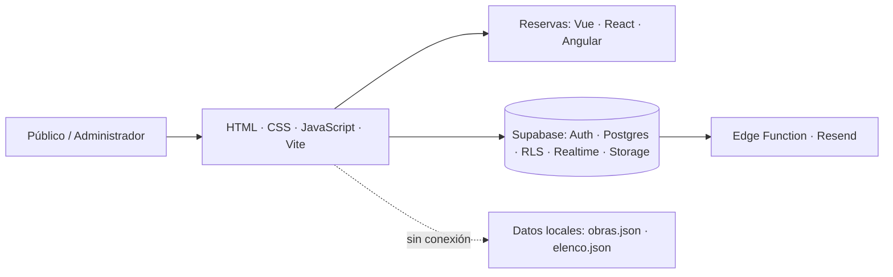

<p align="center"></p>
<p align="center"><strong>Elige tu función, tu butaca y vive el teatro.</strong></p>
<p align="center">El sitio del Taller de Teatro de la UCB: cartelera, reservas con mapa de butacas, entradas con QR y un panel de administración propio.</p>
<p align="center"><a href="https://israelm-ed.github.io/teatro-ucb/">Explorar sitio</a> · <a href="#requisitos-e-instalación">Instalación</a> · <a href="#02--diseño-y-documentación">Diseño y documentación</a></p>
<p align="center">  </p>

## 01 — La experiencia

El Taller de Teatro de la UCB necesitaba un lugar para mostrar su temporada y gestionar las entradas sin papel. El público consulta la cartelera, conoce al elenco, elige su butaca viendo cómo se verá el escenario desde ella y recibe sus entradas con código QR. El equipo del taller administra obras, funciones, talleres y elenco desde un panel propio.


| Funcionalidad | Descripción |
|---|---|
| Cartelera | Obra destacada con sinopsis, horarios, tráiler y su elenco |
| Reservas | Mapa de butacas con vista del escenario y disponibilidad en tiempo real |
| Pago y entradas | Bloqueo de butacas por cinco minutos, QR de pago de demostración y entradas con QR |
| Elenco | Integrantes por paralelo: oficial, juveniles y aspirantes |
| Talleres | Catálogo e inscripción con correo institucional |
| Panel de administración | Resumen de actividad, gestión de contenido y reporte PDF |

## 02 — Diseño y documentación

| Recurso | Enlace |
|---|---|
| Perfil del proyecto | ([Perfil del Proyecto](https://docs.google.com/document/d/1knvR65pMgieGgZwHJj3H4iIsJz7OpolS_A77JqkCkaw/edit?tab=t.0)) |
| Design System, Lo-Fi y Hi-Fi | *(Pendiente: enlace al prototipo de Figma)* |
| Diagramas | *(Pendiente: enlace a los diagramas del sistema)* |
| Esquema de la base de datos | [schema.sql](teatro-ucb-supabase/supabase/schema.sql) |
| Migraciones de Supabase | [Carpeta migrations](teatro-ucb-supabase/supabase/migrations) |

<details><summary>Ver diseño y prototipos</summary>

 

</details>


## 03 — Arquitectura



Es un sitio multipágina construido con Vite. En la sección de reservas conviven tres frameworks: Vue elige la función, React dibuja el mapa de butacas y Angular muestra el resumen. Se cargan bajo demanda y comparten estado mediante un módulo común y eventos DOM. Supabase se encarga de la autenticación, la base de datos con RLS, las RPC, las actualizaciones en tiempo real, el almacenamiento de imágenes y el correo de confirmación (Edge Function con Resend). Si Supabase no está configurado o no responde, la cartelera y el elenco se muestran con los datos locales; el inicio de sesión, las reservas y el panel requieren Supabase.

## 04 — Guía técnica

### Requisitos e instalación

Node.js **20.19+ o 22.12+** y npm, y un proyecto de Supabase.

1. Crea un archivo `.env` en la raíz:
   ```dotenv
   VITE_SUPABASE_URL=https://tu-proyecto.supabase.co
   VITE_SUPABASE_ANON_KEY=tu-clave-anon
   ```
2. Instala y ejecuta:
   ```bash
   npm install
   npm run dev
   ```
3. Abre la dirección que muestra la terminal (normalmente http://localhost:5173).

| Comando | Qué hace |
|---|---|
| `npm run dev` | Servidor de desarrollo con recarga al guardar |
| `npm run build` | Genera los archivos de publicación en `dist/` (la carpeta no se versiona) |
| `npm run preview` | Sirve localmente la versión compilada |

**Base de datos.** En un proyecto nuevo de Supabase, ejecuta `teatro-ucb-supabase/supabase/schema.sql` y después las migraciones en orden desde **SQL Editor**. No se aplican automáticamente.

| # | Migración | Qué agrega |
|---|---|---|
| 1 | `20261118163500_expand_theater_schema.sql` | Tablas de obras, salas, funciones, butacas, órdenes, talleres, inscripciones y convocatorias, y la RPC `butacas_ocupadas` |
| 2 | `20261125170000_admin_theater.sql` | Rol de administrador con RLS y asignación del administrador inicial |
| 3 | `20261125190000_reservations_admin_security.sql` | Disponibilidad por RPC, historial de cancelaciones, Realtime y tokens QR |
| 4 | `20261125192100_work_images_required.sql` | Bucket `obras-portadas` (JPG, PNG o WebP de hasta 5 MB) |
| 5 | `20261125202000_admin_workshops.sql` | Gestión de talleres y bucket `talleres-portadas` |
| 6 | `20261125214000_reservation_holds_and_simulated_qr.sql` | Bloqueo de butacas por cinco minutos y pago QR simulado (no mueve dinero) |
| 7 | `20261126120000_elenco.sql` | Tablas `miembros_elenco` y `elenco_obras` y bucket `elenco` (fotos de hasta 2 MB) |

**Correo de confirmación.** Se envía desde una Supabase Edge Function con Resend. Verifica un dominio en Resend y configura los secretos en Supabase:
El correo se envía desde una Supabase Edge Function usando Gmail API. La cuenta
Gmail que autoriza OAuth será el remitente; el destinatario sigue siendo el
correo de la cuenta autenticada. Nunca pongas credenciales OAuth en el frontend,
en `.env` público ni en variables `VITE_*`.

1. En Google Cloud Console, habilita Gmail API, configura la pantalla de
   consentimiento OAuth y añade la cuenta remitente como usuario de prueba.
2. Crea un cliente OAuth de tipo aplicación web y agrega
   `https://developers.google.com/oauthplayground` como URI de redirección.
3. En OAuth 2.0 Playground, abre la configuración, activa **Use your own OAuth
   credentials** y coloca el ID y secreto del cliente. Autoriza el alcance
   `https://www.googleapis.com/auth/gmail.send`, intercambia el código y copia
   el refresh token.
4. Vincula el proyecto Supabase y guarda las credenciales como secretos:

```bash
cd teatro-ucb-supabase
supabase login
supabase link --project-ref TU_PROJECT_REF
supabase secrets set GMAIL_CLIENT_ID="..." GMAIL_CLIENT_SECRET="..." GMAIL_REFRESH_TOKEN="..." GMAIL_SENDER="tu-cuenta@gmail.com"
supabase functions deploy send-reservation-confirmation
```

Si el correo falla, la reserva se conserva y el usuario puede reintentar el envío.
`GMAIL_SENDER` debe coincidir con la cuenta que concedió OAuth o con un alias de
envío configurado en Gmail. Supabase proporciona `SUPABASE_URL` y
`SUPABASE_SERVICE_ROLE_KEY` a la función. En modo de prueba de Google, los
refresh tokens pueden caducar a los siete días; para uso continuo, revisa los
requisitos de publicación y verificación de Google para el alcance `gmail.send`.
Si el correo falla, la reserva confirmada se conserva y el usuario puede
reintentar el envío desde la pantalla.

### Funcionalidades

| Requisito | Implementación |
|---|---|
| RF-01 Cartelera | Lista navegable con flechas ← → y obra destacada con elenco (`js/main.js`) |
| RF-02 Reservas | Selector de función en Vue, mapa en React y resumen en Angular (`src/`); vista del escenario al pasar el mouse o tocar una butaca |
| RF-03 Bloqueo y pago | Bloqueo por cinco minutos y pago QR simulado mediante RPC (`js/supabase.js`) |
| RF-04 Tiempo real | Supabase Realtime sobre `disponibilidad_butacas`; si se pierde la conexión, consulta cada cinco segundos |
| RF-05 Mis entradas | QR con identificador aleatorio, descarga y cancelación con historial (`js/mis-entradas.js`) |
| RF-06 Obras pasadas | Galería con reseñas, estadísticas y gráfico con Chart.js |
| RF-07 Elenco | `elenco.html` con pestañas por paralelo; `elenco.html#juveniles` abre un paralelo directamente (`js/elenco.js`) |
| RF-08 Talleres | Inscripción con validación de correo `@ucb.edu.bo` (`js/talleres.js`) |
| RF-09 Cuentas | Registro, inicio y cierre de sesión con Supabase Auth (`login.html`, `registro.html`) |
| RF-10 Administración | `admin.html`: resumen, obras, funciones, talleres, elenco con fotos, administradores y reporte PDF (`js/administracion.js`) |
| Interfaz | Cabecera y pie como custom elements, redes en `js/redes.js`, toasts, skeletons, diseño responsivo y `prefers-reduced-motion` |

### Estructura

```text
index.html, elenco.html, login.html, registro.html, admin.html
css/       variables, base, layout, componentes, auth, admin, styles (@import)
js/        main.js, navigation.js, footer.js, redes.js, supabase.js, mis-entradas.js,
           talleres.js, elenco.js, elenco-datos.js, administracion.js, auth.js, toasts.js
src/       FunctionSelector.vue, SeatMap.jsx, ReservationSummary.js, reservation-store.js, main.js
data/      obras.json, elenco.json
public/    assets/ (imágenes del sitio y del README), favicon e íconos
teatro-ucb-supabase/supabase/
           schema.sql, migrations/, functions/send-reservation-confirmation/
.github/workflows/deploy.yml
```

### Configuración y seguridad

- El navegador solo usa `VITE_SUPABASE_URL` y la clave `anon`/publishable, protegidas por RLS. Nunca se usa una clave `service_role` en el frontend ni en variables `VITE_*`; los secretos del correo viven en Supabase.
- Solo los administradores pueden crear, editar o eliminar contenido. La disponibilidad de butacas se consulta por RPC, sin exponer reservas ajenas.
- Una butaca no puede reservarse dos veces en la misma función, y los bloqueos exigen iniciar sesión.
- Los buckets solo aceptan JPG, PNG o WebP con tamaño limitado, y los textos de la base se escapan antes de mostrarse.

### RPC de Supabase

| RPC | Descripción |
|---|---|
| `butacas_ocupadas(p_funcion_id)` | Butacas ocupadas de una función |
| `actualizar_bloqueo_butacas(p_funcion_id, p_butacas)` | Bloquea las butacas elegidas por cinco minutos |
| `mis_bloqueos_butacas(p_funcion_id)` | Butacas bloqueadas por el usuario |
| `confirmar_pago_qr_simulado(p_funcion_id, p_butacas, p_referencia)` | Confirma el pago simulado y crea las reservas |
| `cancelar_mis_reservas(p_reserva_id)` | Cancela una reserva propia |
| `es_administrador()` | Indica si el usuario es administrador |
| `crear_obra_con_funcion(...)`, `retirar_obra(p_obra_id)` | **Admin.** Alta y retiro de obras |
| `agregar_administrador(p_email)`, `quitar_administrador(p_email)` | **Admin.** Gestión de administradores |

## Despliegue

- **GitHub Pages:** [israelm-ed.github.io/teatro-ucb](https://israelm-ed.github.io/teatro-ucb/). Se publica automáticamente con cada push a `main` mediante GitHub Actions (`.github/workflows/deploy.yml`), con `VITE_SUPABASE_URL` y `VITE_SUPABASE_ANON_KEY` como secretos del repositorio. Vite toma el nombre del repositorio para construir las rutas del sitio.
- **Vercel:** *(Pendiente: URL del sitio en Vercel)*. Conectado al mismo repositorio, con las mismas variables de entorno y su URL registrada en **Supabase → Authentication → URL Configuration**.

Las migraciones SQL y la Edge Function se aplican por separado en Supabase; el despliegue del sitio no las ejecuta.


## 05 — Proyecto académico

Tecnologías Web I · Universidad Católica Boliviana "San Pablo", sede La Paz · *(Pendiente: periodo académico)*.

**Integrantes:** *(Pendiente: nombres completos de los integrantes del equipo)* · [Historial de contribuciones](https://github.com/IsraelM-Ed/teatro-ucb/graphs/contributors)

El proyecto utiliza imágenes y videos de terceros; sus derechos corresponden a sus respectivos titulares.

